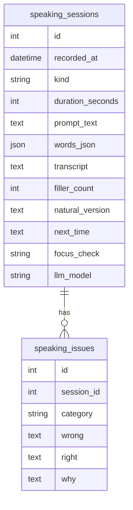
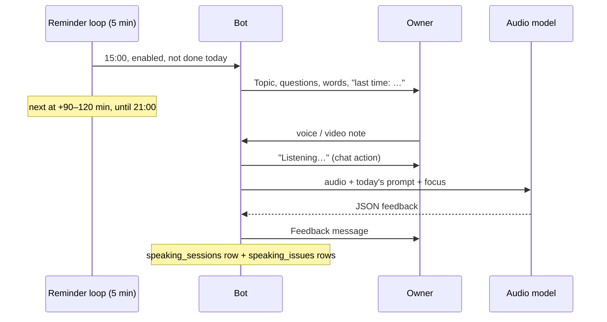

# Speaking practice (voice messages and video notes) — design

Date: 2026-11-12. Status: agreed in chat; spike done the same day (see "Spike results"), ready to implement.
Inspiration: Speak Easy English with James, "Your 75-Day English Speaking Plan" (habit 2: record yourself
every day, review the recording, pick one thing to fix next time).

## Goal

Words reviewed in the Mini App should also reach speech. Once a day the bot suggests a short speaking
topic with a few questions and 2–3 words from the deck; the owner answers with a voice message or a
video note in the bot chat and gets written feedback: filler words, which deck words were used, a few
fixes, a more natural version and **one thing to work on next time**, which the next prompt repeats.

Success: the owner records on most days for 4+ weeks.

## Non-goals

- Storing the recordings themselves (audio or video files) on our side (see "What is stored").
- Feedback on body language from the video (the video note's picture is ignored; maybe later, Gemini
  accepts video).
- Pronunciation feedback (no `pronunciation` issue category: the spike did not check how reliable the
  model is at it), streaks, a history screen in the Mini App, the "day 1 vs day 75" comparison
  as a feature: the recordings stay in the Telegram chat, which is the archive.
- Recording inside the Mini App (Telegram already records voice and video notes).

## Decisions

| Topic | Decision |
|---|---|
| Input | Voice messages (`voice`, OGG/Opus, no length limit in Telegram) and video notes (`video_note`, MP4, up to 60 s). Only the audio track is analysed. Bot API downloads files up to 20 MB (≈1.5 h of voice). Recordings longer than 15 min (`SPEAKING_MAX_SECONDS`, from `duration` in the update, before downloading) are refused to keep each call bounded. |
| Analysis | One request to an audio-capable model through OpenRouter (`/chat/completions`, `input_audio` base64). No separate STT step: the model hears fillers and pauses, which STT usually cleans away. Model in `SPEAKING_LLM_MODEL`, default `google/gemini-3.8-flash` (the card model, Haiku, has no audio input; flash-lite lost in the spike). |
| Cost | Measured: $0.0023 for a 47 s voice message on `gemini-3.8-flash` (~1 000 prompt tokens of audio + text, ~350 output). One minute a day ≈ $0.1 a month, 5 minutes a day ≈ $0.4. Not a concern at any frequency. |
| Fillers | Counted by code from the transcript (`um`, `uh`, `er`, `erm`, `hmm`, case-insensitive whole words), not by the model: the spike showed model counts that disagree with its own transcript. "like" / "you know" are not counted (too ambiguous for a regex). |
| Provider privacy | Requests carry `provider: {"data_collection": "deny"}` so OpenRouter routes only to providers that do not store or train on inputs (Gemini still routes, checked in the spike). |
| Prompt | Generated by the card LLM (`LLM_MODEL`, text only) when the first reminder of the day goes out, or on `/speak`: a topic, 2–3 short questions, the chosen words and, if present, the last "next time" note. One fixed weekday (Saturday) is a story day: "tell a story with a beginning, middle and end". |
| Deck words | 3 cards picked at random from learning cards in `srs_state = review` (known well enough to use); fewer than 3 → filled from other learning cards; none → the prompt has no words. |
| Reminders | Separate from the review reminder, every day. First at 15:00 local (`SPEAKING_FIRST_HOUR`), follow-ups at a random 90–120 min gap after the previous one, none from 21:00 on (`SPEAKING_LAST_HOUR`, no reminder at or after it). None once a recording was answered today. Same backoff as reviews with its own counter: 3 ignored days → only the first reminder, every other day; 7 → paused until the next recording or `/speak`. |
| Switch | `speaking_enabled` in Settings (default on); off stops reminders, recordings are still analysed. |
| Copy | English, sentence case, like the rest of the bot. |

## What is stored

The media never lands on our side: the audio/video file is downloaded into memory, sent to the model
and dropped; no file on disk, no Telegram `file_id`. Everything derived from it is kept.



`speaking_sessions`, one row per analysed recording:

- `id`
- `recorded_at` (UTC)
- `kind` (`voice`, `video_note`)
- `duration_seconds` (from the Telegram update)
- `prompt_text` (the prompt it answered; null for free speech)
- `words_json` (`[{card_id, word, used}]`: the prompt's words with the model's verdict; `[]` for free
  speech; `card_id` stays as a plain number, the card may be deleted later)
- `transcript` (from the model, fillers kept)
- `filler_count` (counted by code from `transcript`, see "Fillers")
- `natural_version`
- `next_time` (the "one thing" for the next prompt)
- `focus_check` (`better`, `same`, `worse`; null when there was no previous note)
- `llm_model`

`speaking_issues`, one row per fix (FK `session_id` → `speaking_sessions.id`, cascade delete,
indexed together with `category`):

- `id`
- `session_id`
- `category` (one of the fixed list in the contract)
- `wrong`, `right` (nullable both, like the sentence check: a general "not how people say it" note)
- `why`

The issues live in their own table so recurring mistakes can be counted with plain SQL ("last 30
days: article 14, preposition 9, tense 6"). Fillers per minute (`filler_count / duration_seconds`),
words never used in speech and `focus_check` trends come from `speaking_sessions`.

"Recorded today" and the last `next_time` are read from the latest session. Failed analyses are not
stored.

Reminder state in `app_settings` (single row, overwritten):

- `speaking_enabled` (bool, default true)
- `speaking_prompt` (text: today's prompt as sent; the analysis needs the topic and questions)
- `speaking_prompt_words_json` (`[{card_id, word}]` of today's prompt)
- `speaking_prompt_on` (date of `speaking_prompt`)
- `speaking_reminder_on`, `speaking_next_reminder_at` (UTC), `speaking_ignored` (int)

One Alembic migration adds both tables and the columns. The history is not shown anywhere yet; it is
there for later analysis and for the daily backups. Feeding the week's most frequent categories into
the next prompt is a later step, once there is data.

## Flow



A recording without a prompt for today (sent before 15:00 or on a disabled day) is analysed as free
speech: no topic, no words, only the last "next time" note; `/speak` gets a prompt first. A recording
sent after one was already analysed today is analysed too (practice twice is fine) and adds its own row.

## Messages

Prompt (reminder and `/speak`):

```
Speaking practice
Topic: a place you'd like to go back to
1. Where is it and when were you there?
2. What made it special?
3. Would it be the same now?
Try to use: vivid, linger, worth it
Last time: when you need a second, say "let me think" instead of "uh".

Answer with a voice message or a video note, 1–3 min.
```

Follow-ups are one line with the topic, e.g. "Still time for 2 minutes of speaking? Topic: …".

Feedback (Telegram HTML):

```
Feedback · 1:42
Last time's focus: better
Fillers: 9 (um ×6, uh ×3) · 5.3 per min
Words: ✓ vivid  ✓ worth it  ✗ linger
Fixes:
• <s>I have been there in 2019</s> → I was there in 2019 — finished time, past simple
• <s>it was very interesting place</s> → it was a really interesting place — article
Sounds more natural: "I went there back in 2019, and what stuck with me was …"
Next time: finish the story with one sentence on how it ended.
```

The "Last time's focus" line only when `focus_check` is set; the category is not shown in the chat.

## LLM contract (`speaking_feedback`)

```json
{
  "ok": true,
  "transcript": "...",
  "words_used": [{"word": "vivid", "used": true}],
  "fixes": [{"wrong": "...", "right": "...", "why": "...", "category": "article"}],
  "natural_version": "...",
  "next_time": "...",
  "focus_check": "better"
}
```

- `category`: one of `article`, `tense`, `verb_pattern` (gerund/infinitive, verb + preposition
  patterns), `preposition`, `collocation`, `word_choice`, `word_order`, `agreement`, `grammar_other`.
  An unknown value fails validation (one retry, like any invalid response).
- `focus_check`: did the learner follow the previous `next_time` note: `better`, `same`, `worse`;
  `null` when the prompt had no previous note.

- `ok = false` with `message_for_user` when there is no English speech (silence, another language).
- `transcript`: verbatim, fillers kept ("um", "uh"); stored, not sent to the chat; the filler count
  is computed from it.
- `fixes`: 0–4 items, `why` a few words, same shape as the sentence check (`SentenceIssue`).
- `natural_version`: 1–3 sentences rewriting the weakest part, not the whole answer.
- `next_time`: exactly one concrete thing, at most ~150 characters; the model is told to pick the most
  useful one and prefer thinking phrases ("let me think", "the thing is") over "stop saying um".
- `words_used` covers exactly the prompt's words; inflected forms count.
- Validated with Pydantic like the other contracts; one retry on invalid JSON (the existing client
  behaviour); then the bot answers "Couldn't check this recording. Please try again."

Reasoning: `{effort: "low"}` (used in the spike). Request also carries
`provider: {"data_collection": "deny"}` and `response_format: {"type": "json_object"}`.

## Bot

- `/speak` — sends today's prompt (generates it if missing); resets `speaking_ignored` like a recording.
  Added to the command list in `deploy/telegram/profile.py`.
- Message handlers for `voice` and `video_note` from the allowed user; the rate limit is shared with
  text messages. Shows `record_voice`/`typing` chat action while the model works.
- Download with `bot.download(file)` into `BytesIO`; voice → `input_audio` with `format: "ogg"`; video note → the MP4 as is, `input_audio` with
  `format: "mp4"` (only the sound is analysed; no `ffmpeg`).

## Settings (Mini App)

One switch "Speaking practice" in Settings (`speaking_enabled`, `GET`/`PUT /api/settings`). Hours are
constants for now.

## Spike results (2026-11-12)

Two real recordings of the owner from Telegram Desktop: a voice message (OGG/Opus, 47 s) and a video
note (MP4 480×480, H.264 + AAC, 42 s). Throwaway script, prompt close to the contract above.

| Variant | Accepted | Latency | Cost | Quality |
|---|---|---|---|---|
| `gemini-3.5-flash-lite`, OGG as `input_audio` | yes | 4.2 s | $0.0013 | 1 fix, missed "suggested to speak", "mistakes you did" |
| `gemini-3.8-flash`, OGG as `input_audio` | yes | 5.8 s | $0.0023 | 4 correct, useful fixes (article, suggest + -ing, "to yourself", make a mistake); filler count matches its transcript |
| `gemini-3.5-flash-lite`, MP4 as `input_audio` (`mp4`) | yes | 8.2 s | $0.0012 | 1 fix; filler list with a `like: 0` entry; `next_time` off ("As a result") |
| `gemini-3.5-flash-lite`, MP4 as video part | yes | 10.3 s | $0.0012 | same tokens as audio: only the sound is used |

- Both formats go straight in; no `ffmpeg`. Video notes stay in the MVP.
- `provider.data_collection: "deny"` routes to Google fine.
- flash-lite filler counts varied between runs and disagreed with its own transcript → filler counting
  moved to code; `gemini-3.8-flash` is the default.
- Not measured: 5-minute recordings (latency should stay well under the 180 s client timeout).

## Tests

- Reminder decisions: first at 15:00, random gap within 90–120 min (seeded), nothing at/after 21:00,
  nothing after a recording today, backoff and pause, disabled switch.
- Word picking: review-state first, fill-up, empty deck.
- Filler counting from a transcript (whole words, case, "umbrella" not counted).
- Feedback schema validation (unknown category, `focus_check` values) and rendering (HTML escaping,
  fixes, missing words, focus line only when set).
- Handlers: voice → client called with OGG bytes and today's prompt; too long → refused before
  download; foreign user ignored; model error → retry message and no rows; success → one
  `speaking_sessions` row (with `card_id`s in `words_json`) and one `speaking_issues` row per fix, no
  media written to disk.

## Docs

After implementation: `AGENTS.md` gains a "Speaking practice" section (input, analysis, reminders,
what is stored), the new env var `SPEAKING_LLM_MODEL` and the `/speak` command.
