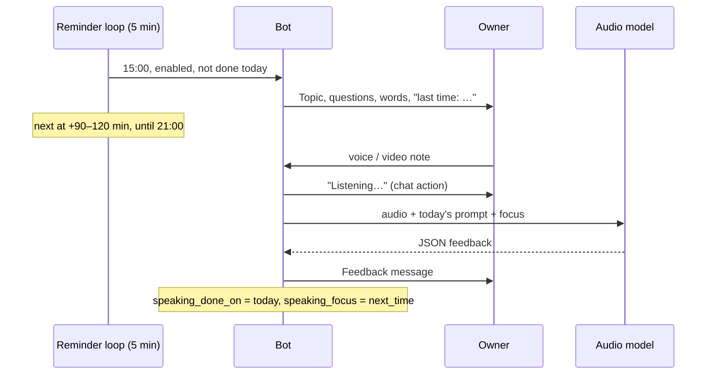

# Speaking practice (voice messages and video notes) — design

Date: 2026-11-12. Status: agreed in chat; the model choice and the video-note format wait for the spike (see "Spike").
Inspiration: Speak Easy English with James, "Your 75-Day English Speaking Plan" (habit 2: record yourself
every day, review the recording, pick one thing to fix next time).

## Goal

Words reviewed in the Mini App should also reach speech. Once a day the bot suggests a short speaking
topic with a few questions and 2–3 words from the deck; the owner answers with a voice message or a
video note in the bot chat and gets written feedback: filler words, which deck words were used, a few
fixes, a more natural version and **one thing to work on next time**, which the next prompt repeats.

Success: the owner records on most days for 4+ weeks.

## Non-goals

- Storing recordings, transcripts or feedback on our side (see "What is stored").
- Feedback on body language from the video (the video note's picture is ignored; maybe later, Gemini
  accepts video).
- Pronunciation scoring, streaks, a history screen in the Mini App, the "day 1 vs day 75" comparison
  as a feature: the recordings stay in the Telegram chat, which is the archive.
- Recording inside the Mini App (Telegram already records voice and video notes).

## Decisions

| Topic | Decision |
|---|---|
| Input | Voice messages (`voice`, OGG/Opus, no length limit in Telegram) and video notes (`video_note`, MP4, up to 60 s). Only the audio track is analysed. Bot API downloads files up to 20 MB (≈1.5 h of voice). Recordings longer than 15 min (`SPEAKING_MAX_SECONDS`, from `duration` in the update, before downloading) are refused to keep each call bounded. |
| Analysis | One request to an audio-capable model through OpenRouter (`/chat/completions`, `input_audio` base64). No separate STT step: the model hears fillers and pauses, which STT usually cleans away. Model in `SPEAKING_LLM_MODEL` (the card model, Haiku, has no audio input). Candidates: `google/gemini-3.5-flash-lite`, `google/gemini-3.8-flash`; the spike picks one. |
| Cost | ~1 900 audio tokens per minute on Gemini. Per 1-minute recording ≈ $0.002 (flash-lite) / $0.005 (flash); one a day is under $0.2 a month. Not a concern at any frequency. |
| Provider privacy | Requests carry `provider: {"data_collection": "deny"}` so OpenRouter routes only to providers that do not store or train on inputs (verify in the spike that Gemini still routes). |
| Prompt | Generated by the card LLM (`LLM_MODEL`, text only) when the first reminder of the day goes out, or on `/speak`: a topic, 2–3 short questions, the chosen words and, if present, the last "next time" note. One fixed weekday (Saturday) is a story day: "tell a story with a beginning, middle and end". |
| Deck words | 3 cards picked at random from learning cards in `srs_state = review` (known well enough to use); fewer than 3 → filled from other learning cards; none → the prompt has no words. |
| Reminders | Separate from the review reminder, every day. First at 15:00 local (`SPEAKING_FIRST_HOUR`), follow-ups at a random 90–120 min gap after the previous one, none from 21:00 on (`SPEAKING_LAST_HOUR`, no reminder at or after it). None once a recording was answered today. Same backoff as reviews with its own counter: 3 ignored days → only the first reminder, every other day; 7 → paused until the next recording or `/speak`. |
| Switch | `speaking_enabled` in Settings (default on); off stops reminders, recordings are still analysed. |
| Copy | English, sentence case, like the rest of the bot. |

## What is stored

Nothing about the recordings: no audio, no file ids, no transcripts, no feedback text, no history
table. The audio is downloaded into memory, sent to the model and dropped; logs record only duration,
model, latency and errors, never the text.

Only the state needed to run the reminders, in `app_settings` (single row, overwritten):

- `speaking_enabled` (bool, default true)
- `speaking_prompt` (text: today's prompt as sent; the analysis needs the topic and words)
- `speaking_prompt_on` (date of `speaking_prompt`)
- `speaking_focus` (text: the last "next time" note, max ~200 chars)
- `speaking_done_on` (date of the last analysed recording)
- `speaking_reminder_on`, `speaking_next_reminder_at` (UTC), `speaking_ignored` (int)

Alembic migration adds these columns; nothing else changes in the schema.

## Flow



A recording without a prompt for today (sent before 15:00 or on a disabled day) is analysed as free
speech: no topic, no words, only the last `speaking_focus`; `/speak` gets a prompt first. A recording sent after one
was already analysed today is analysed again (practice twice is fine); `speaking_focus` takes the
latest note.

## Messages

Prompt (reminder and `/speak`):

```
Speaking practice
Topic: a place you'd like to go back to
1. Where is it and when were you there?
2. What made it special?
3. Would it be the same now?
Try to use: vivid, linger, worth it
Last time: fewer "like" fillers — pause instead.

Answer with a voice message or a video note, 1–3 min.
```

Follow-ups are one line with the topic, e.g. "Still time for 2 minutes of speaking? Topic: …".

Feedback (Telegram HTML):

```
Feedback · 1:42
Fillers: 9 (um ×6, like ×3)
Words: ✓ vivid  ✓ worth it  ✗ linger
Fixes:
• <s>I have been there in 2019</s> → I was there in 2019 — finished time, past simple
• <s>it was very interesting place</s> → it was a really interesting place — article
Sounds more natural: "I went there back in 2019, and what stuck with me was …"
Next time: when you need time, say "let me think" instead of "um".
```

## LLM contract (`speaking_feedback`)

```json
{
  "ok": true,
  "duration_note": null,
  "fillers": {"total": 9, "top": [{"word": "um", "count": 6}, {"word": "like", "count": 3}]},
  "words_used": [{"word": "vivid", "used": true}],
  "fixes": [{"wrong": "...", "right": "...", "why": "..."}],
  "natural_version": "...",
  "next_time": "..."
}
```

- `ok = false` with `message_for_user` when there is no English speech (silence, another language).
- `fixes`: 0–4 items, `why` a few words, same shape as the sentence check (`SentenceIssue`).
- `natural_version`: 1–3 sentences rewriting the weakest part, not the whole answer.
- `next_time`: exactly one concrete thing, at most ~150 characters; the model is told to pick the most
  useful one and prefer thinking phrases ("let me think", "the thing is") over "stop saying um".
- `words_used` covers exactly the prompt's words; inflected forms count.
- Validated with Pydantic like the other contracts; one retry on invalid JSON (the existing client
  behaviour); then the bot answers "Couldn't check this recording. Please try again."

Reasoning: `{effort: "low"}` (spike may change it).

## Bot

- `/speak` — sends today's prompt (generates it if missing); resets `speaking_ignored` like a recording.
  Added to the command list in `deploy/telegram/profile.py`.
- Message handlers for `voice` and `video_note` from the allowed user; the rate limit is shared with
  text messages. Shows `record_voice`/`typing` chat action while the model works.
- Download with `bot.download(file)` into `BytesIO`; voice → `format: "ogg"`; video note → per the spike.

## Settings (Mini App)

One switch "Speaking practice" in Settings (`speaking_enabled`, `GET`/`PUT /api/settings`). Hours are
constants for now.

## Spike (before implementation)

On 1–2 real recordings of the owner (one voice, one video note), with a throwaway script:

1. Does OpenRouter + Gemini accept OGG/Opus as `input_audio` directly? Does it accept the video note's
   MP4 (as `input_audio` with `format: "mp4"`/`"aac"`, or as a video part)? If MP4 needs `ffmpeg`,
   video notes are dropped from the MVP instead of adding `ffmpeg` to the image (ask first).
2. flash-lite vs flash: filler counts close to a manual count, `words_used` correct, `next_time` useful,
   latency for 1 and 5 minutes.
3. `provider.data_collection: "deny"` still routes to the chosen model.

## Tests

- Reminder decisions: first at 15:00, random gap within 90–120 min (seeded), nothing at/after 21:00,
  nothing after a recording today, backoff and pause, disabled switch.
- Word picking: review-state first, fill-up, empty deck.
- Feedback schema validation and rendering (HTML escaping, fixes, missing words).
- Handlers: voice → client called with OGG bytes and today's prompt; too long → refused before
  download; foreign user ignored; model error → retry message; state updated (`speaking_done_on`,
  `speaking_focus`), no recording data persisted.

## Docs

After implementation: `AGENTS.md` gains a "Speaking practice" section (input, analysis, reminders,
what is stored), the new env var `SPEAKING_LLM_MODEL` and the `/speak` command.
